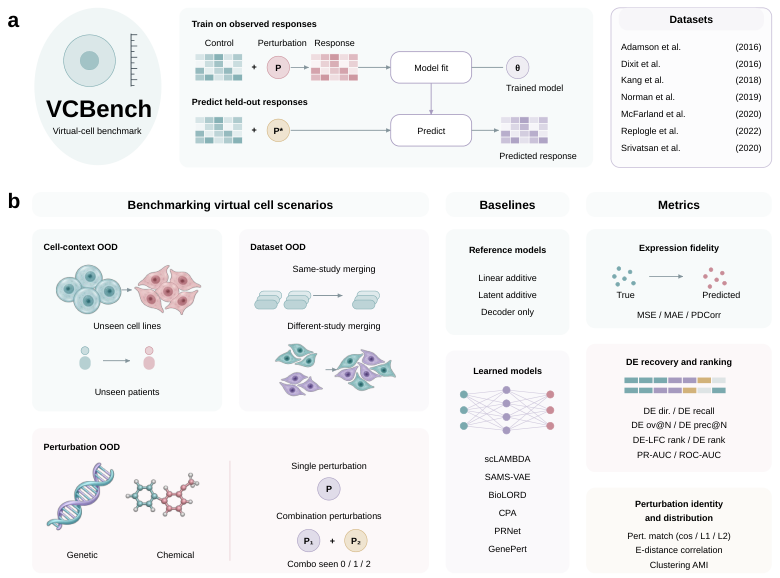

# VCBench Website

Companion website for **VCBench: Benchmarking Virtual Cell Models for In-the-Wild Perturbation Response**.

Project Links:
[Website](https://maoxinjie.github.io/VCBench-demo/)  
[Code](https://github.com/maoxinjie/VCBench/)
[arXiv](https://doi.org/10.48550/arXiv.2604.27646)

## Benchmark update

The six main figures and result summaries reflect the manuscript build dated
2026-11-16. Figures 1–5 cover the benchmark design and computational results;
Figure 6 shows the computational evaluation workflow. The arXiv link points to
the public preprint, which may show an earlier figure set.

The core comparison includes nine models and nine data packages from seven
studies. The model table uses the task mean ranks in
[`assets/results/core-mean-ranks.csv`](assets/results/core-mean-ranks.csv)
(Figure 5b). It averages six common metric ranks equally within each task,
using three-seed mean scores and excluding Random splits. Rank 1 is best;
MSE is ranked from low to high.

For a local preview, serve the repository root with `python3 -m http.server 8000`
and visit `http://127.0.0.1:8000/`.
